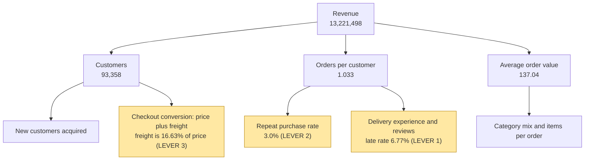

# Revenue levers and assumptions

## 1. Metric tree

Revenue = Customers x Orders per customer x Average order value (delivered orders only).

Baseline from the data: 93,358 customers x 1.033 orders per customer x 137.04 average order value = 13,221,498 revenue.

## 2. Summary of the three levers

Effects are in the same currency units as the dataset and cover the whole period of the data (about two years). Low is half the assumed change and high is double it.

| Lever | Assumption | Low | Base | High | Base as % of revenue |
|---|---|---|---|---|---|
| 2. Raise repeat purchase | Repeat rate up 1.0 percentage point | 70,360 | 140,720 | 281,440 | 1.1% |
| 3. Cut freight in high-freight categories | Freight down 10% on 12 watch-list categories, elasticity 0.5 | 22,730 | 45,461 | 90,922 | 0.3% |
| 1. Reduce late deliveries | Late deliveries cut by 33% | 822 | 1,644 | 3,288 | 0.0% |

## 3. Lever details

### Lever 1: Reduce late deliveries
- **Measured:** 6.77% of delivered orders arrive late. Late orders average a review of 2.27 against 4.29 for on-time orders, and 62.36% of them get 1-2 stars against 9.23%.
- **Measured:** customers whose first order was late reorder at 2.52%, against 3.04% when the first order was on time.
- **Assumption:** late deliveries fall by 33%, for example through more realistic delivery estimates and coaching of the worst sellers.
- **Estimate:** If 33% of late first orders arrived on time, about 11 more customers would reorder, worth about 1,644 in revenue. It would also avoid roughly 1,146 one- or two-star reviews.
- **Action path:** 25 flagged sellers account for 4.9% of all late orders, so seller coaching is the practical way to pull this lever.
- **Caveat:** this is an association; late delivery may not be the only reason these customers reorder less.

### Lever 2: Raise repeat purchase
- **Measured:** 3.0% of customers order more than once, with 1.033 orders per customer on average. A repeat customer places about 1.10 extra orders.
- **Assumption:** a retention programme lifts the repeat rate by 1.0 percentage point, which is 934 extra repeat customers.
- **Estimate:** about 140,720 in revenue at the average order value of 137.04.
- **Caveat:** the size of the uplift is an assumption; it should be tested with a real experiment.

### Lever 3: Cut freight cost in high-freight categories
- **Measured:** freight is 16.63% of item price overall. 12 large categories sit above that level, with 5,232,913 in revenue and 1,100,414 in freight.
- **Assumption:** freight in those categories falls by 10% (for example through carrier renegotiation or a free-shipping threshold), and sales respond with an elasticity of 0.5.
- **Estimate:** customers would pay about 110,041 less in freight, a 1.74% drop in total price paid, which would add about 45,461 in revenue.
- **Caveat:** the elasticity is illustrative, not measured, and who pays for the freight cut is not modelled.

## 4. Limits
- The data has no product costs, so these are revenue effects, not profit effects.
- Levers 2 and 3 rest on assumptions, not on measured responses. Lever 1 uses a measured association.
- Effects overlap, so the three should not simply be added together.
- Late-first-order customers reorder less, but the data cannot prove lateness is the cause.
